<p align="center"></p>
<h1 align="center">JobAgent</h1>
<p align="center"><b>Find the role. Reach the people. You press Submit.</b></p>
<p align="center">A local job-search agent that reads every posting, finds the people who can refer you, writes in your voice, and fills the form.</p>
<p align="center">
  <a href="https://github.com/PundarikakshNTripathi/JobAgent/actions/workflows/ci.yml"></a>
  
  
  
</p>

<p align="center">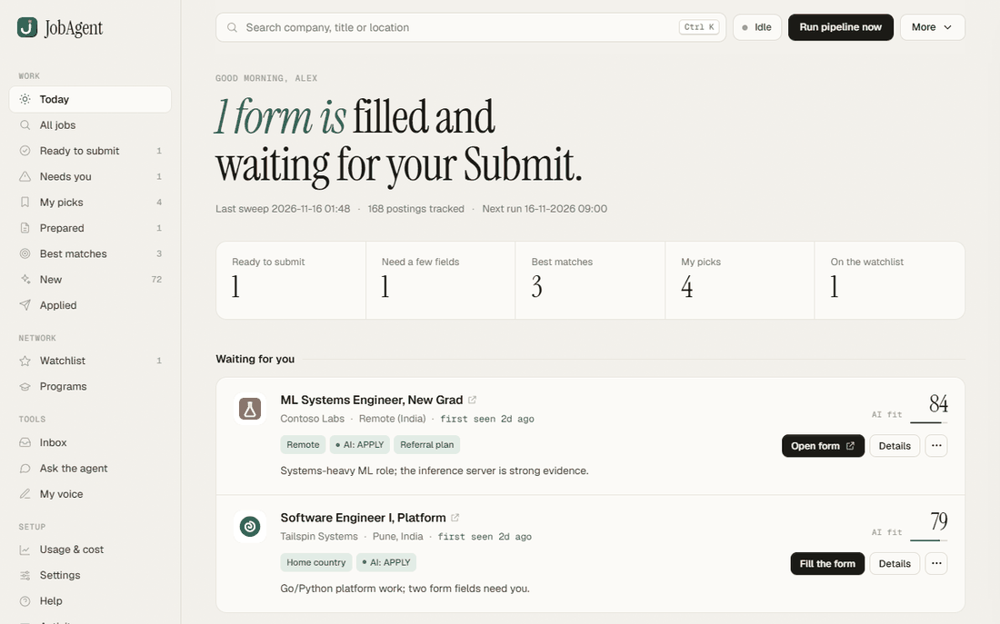</p>

| Find the role | Reach the people | You press Submit |
|---|---|---|
| Watches hundreds of career pages and reads every promising job description **in full**, dropping roles that need years you don't have, a degree you aren't doing, or a citizenship you don't hold. | Finds **real people** you know, or can reach through a mutual connection, at each company, through your own logged-in LinkedIn, and drafts messages that sound like you. | Writes the cover letter, answers the form questions and **fills the application** in its own browser. It never submits, sends or connects. The last click is yours. |

<table><tr>
<td width="50%"><b>Ask in plain words or <code>/commands</code></b><br>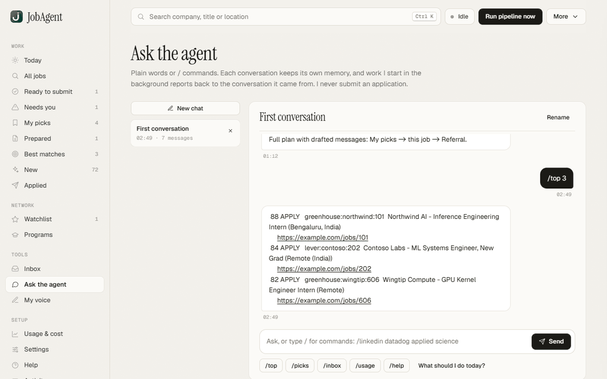</td>
<td width="50%"><b>Ctrl K: anything in two keystrokes</b><br>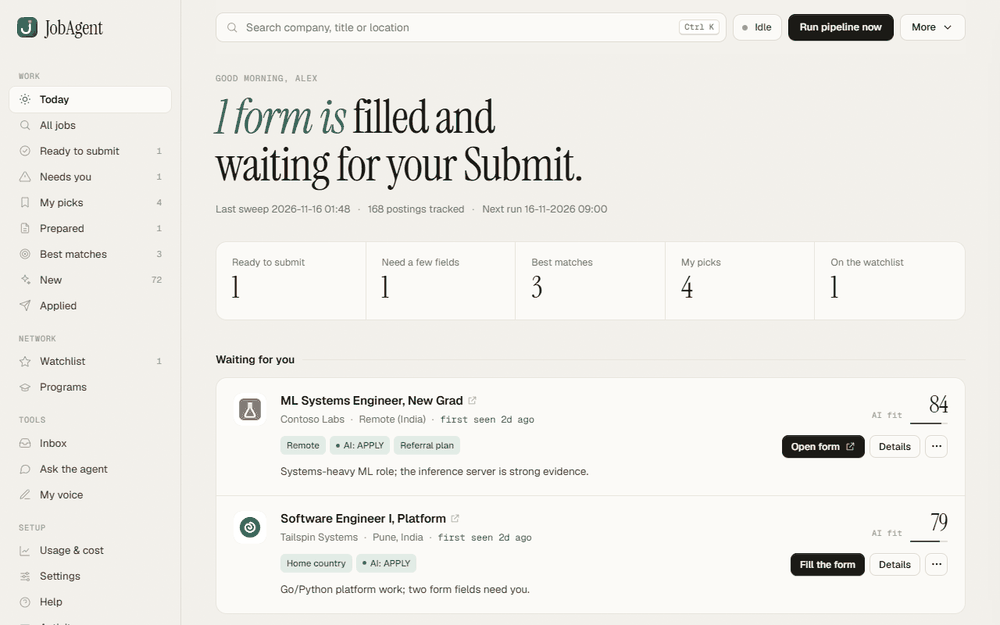</td>
</tr></table>

Works with the AI you already have, alone or mixed:
- **CLI tools:** Claude Code, Google Antigravity (Gemini), Codex, Gemini CLI.
- **APIs:** any OpenAI-compatible API, or the Anthropic API.
- **On your own GPU:** a **local model** run by llama.cpp.

Runs on **Windows, macOS and Linux**. Everything personal stays on your computer. Brand and voice: [docs/BRAND.md](docs/BRAND.md).

---

## Contents
1. [Install (one command)](#1-install-one-command)
2. [Your first 15 minutes](#2-your-first-15-minutes)
3. [How it works](#3-how-it-works)
4. [The app (GUI)](#4-the-app-gui)
5. [Ask the agent: plain words or slash commands](#5-ask-the-agent-plain-words-or-slash-commands)
6. [The browser: LinkedIn, YC, job boards, any page](#6-the-browser-linkedin-yc-job-boards-any-page)
7. [Referrals: real people, real messages](#7-referrals-real-people-real-messages)
8. [The eligibility gate: full job descriptions](#8-the-eligibility-gate-full-job-descriptions)
9. [Form filling (never submits)](#9-form-filling-never-submits)
10. [Models: hosted, mixed, and local AI](#10-models-hosted-mixed-and-local-ai)
11. [Cost and quota control](#11-cost-and-quota-control)
12. [Command line reference](#12-command-line-reference)
13. [Configuration](#13-configuration)
14. [Privacy and safety](#14-privacy-and-safety)
15. [Troubleshooting and FAQ](#15-troubleshooting-and-faq)
16. [For developers](#16-for-developers)

---

## 1. Install (one command)

**Windows** (PowerShell):
```powershell
irm https://raw.githubusercontent.com/PundarikakshNTripathi/JobAgent/main/install.ps1 | iex
```
**macOS / Linux**:
```bash
curl -fsSL https://raw.githubusercontent.com/PundarikakshNTripathi/JobAgent/main/install.sh | bash
```
> The one-liners download from GitHub, so they work once the repository is public. Until then, clone the repository and run `install.ps1` / `bash install.sh` from the folder; it does the same thing.

What the installer does:
1. Finds Python 3.10+. If it's missing, it offers to install it through winget, Homebrew, apt, dnf, pacman or zypper.
2. Downloads JobAgent to `~/.jobagent/app`, or `%USERPROFILE%\.jobagent\app` on Windows. Override with `JOBAGENT_DIR`.
3. Creates a private Python environment (`.venv`) and installs Playwright, the only package needed.
4. Uses your Chrome, Edge or Chromium. If none is installed, it installs a Chromium that only JobAgent uses. On minimal Linux it offers the system libraries the browser needs.
5. Asks where your **personal workspace** should live (default `~/JobAgent`).
6. Adds a `jobagent` command (`jobagent gui`, `jobagent doctor`, …).
7. Starts the **setup wizard**. It asks only where your choice matters and shows a default you accept with Enter:

| Step | You choose | Default |
|---|---|---|
| Profile | name, contact, education, your best projects with numbers | — |
| AI providers | use the recommended mix of what it found installed | Claude for writing and the browser; Antigravity/Gemini for research |
| Local AI | set up a free model on your GPU (it detects your GPU and VRAM and recommends one, or none) | no (you can do it later) |
| Browser logins | open the agent's browser now to log in to LinkedIn and YC Work at a Startup | yes |
| Schedule | twice a day / once a day / custom times / none | twice: 09:00 and 18:00 |
| Notifications | an ntfy topic for phone pushes (desktop notifications are always on) | skip |

**Other ways to run it:**
- **Unattended:** set `JOBAGENT_DEFAULTS=1` to accept every default. `JOBAGENT_SKIP_SCHEDULE=1` skips the scheduler.
- **Change your answers later:** `jobagent init --reconfigure`.
- **Update:** run the installer again; your data is kept.
- **Uninstall:** run `jobagent remove-schedule`, then delete the app folder. Your workspace stays until you delete it yourself.

**Manual install** (any OS):
```bash
git clone https://github.com/PundarikakshNTripathi/JobAgent.git && cd JobAgent
python -m venv .venv && .venv/bin/python -m pip install -r requirements.txt      # Windows: .venv\Scripts\python
.venv/bin/python agent/run.py init
```

---

## 2. Your first 15 minutes

1. **Run `jobagent doctor`.** Every line should say ready/OK: profile, at least one AI provider, the browser, and the schedule.
2. **Log in once in the agent's browser** to LinkedIn and YC Work at a Startup. The wizard opens it for you, and `jobagent gui` → Settings has a button too. These sessions live only in JobAgent's own browser profile.
3. **Run `jobagent gui`.** It opens `http://127.0.0.1:8777` with a short guided tour.
4. **Press Run pipeline now** (top right) for the first sweep. The button shows the current stage live.
5. **Teach it your voice.** Go to **My voice** and paste 3–5 messages you really sent. Drafts will sound like you from then on.
6. **Each day:**
   - Open **Today**.
   - Read **Waiting for you** (forms ready for your Submit) and the plan.
   - Ask the agent for anything else in plain words.

---

## 3. How it works

One **run** of the pipeline (the schedule runs it at your chosen times; you can also press *Run pipeline now*, or use `jobagent cycle` or `/cycle`):

| # | Step | Model? | What happens |
|---|---|---|---|
| 1 | Inbox | yes | Links and texts you pasted are read and judged first. |
| 2 | Poll | no | About 150 company boards (Greenhouse, Lever, Ashby, SmartRecruiters, Workable, Workday tenants, Eightfold), official career sites (Google, Microsoft, Amazon, NVIDIA, …), YC, Hacker News, VC portfolio boards, GitHub new-grad lists. Duplicates are merged: aggregator copies and identical re-posts are hidden, and the copy you worked on is always kept. |
| 3 | Score | no | Role family, level, location realism (home, remote, relocate), visa clarity, your learned preferences. |
| 4 | **Read full JDs** | no | The full posting is fetched (ATS APIs → page → your logged-in browser). Roles you don't qualify for are dropped **before** any model is paid to look at them (section 8). |
| 5 | Triage | yes | APPLY / STRETCH / SKIP, fit score, resume variant, the exact gap. |
| 6 | Packets | yes | Cover letter, answers to the real form questions, honest odds, resume advice. |
| 7 | Referrals | yes (small) | Real people from your LinkedIn network, ranked, with messages in your voice (section 7). |
| 8 | Form fill | yes (small) | Reads the form, maps your answers, fills it, and leaves it for your Submit (section 9). |
| 9 | Learn and plan | yes (small) | Updates memory from your outcomes (applied, skipped and why), builds today's plan, notifies you. |

Prestige roles (frontier-lab fellowships, residencies, pre-docs, safety programs) go to a **watchlist**: referral first, never auto-applied.

---

## 4. The app (GUI)

`jobagent gui` (or `start_gui.bat` on Windows). It runs on localhost only, has light and dark themes, works at phone width, and has a command palette (**Ctrl K** / **⌘ K**). The interface loads two typefaces from Google Fonts and falls back to system fonts offline.

| View | What it is for |
|---|---|
| **Today** | Opens with your next action ("2 forms are waiting for your Submit"), then the forms waiting for you, the day's plan and the watchlist. |
| **All jobs** | A job-board browser over every posting, with filters for keywords, role family, level, years of experience, location, visa, company tier, source and freshness. Every row opens the employer's posting. |
| **My picks** | Everything *you* chose to work on: a step tracker (application, referral plan, resume advice, form filled), a **May not fit** badge when the job description rules you out, and **Who you know there** with profile links. |
| **Ready to submit / Needs you** | Filled forms waiting for your Submit, and the exact fields that need you. |
| **Watchlist / Programs** | Prestige roles and fellowships: deadlines, eligibility, referral state. |
| **Inbox** | Paste links or texts you found anywhere. Each is processed, stored, and retried if a model was busy. |
| **Ask the agent** | Chat plus slash commands (section 5). Ctrl K opens the same commands from anywhere. |
| **My voice** | Your real sent messages and your edits to drafts, so outreach sounds like you. |
| **Usage & cost** | Calls and tokens per provider and task, today, this week and this month. |
| **Settings** | Providers and which model does which job, schedule times, daily limits, budgets, notifications, local AI. |

**All jobs:** filter like a job board, then reset in one click.

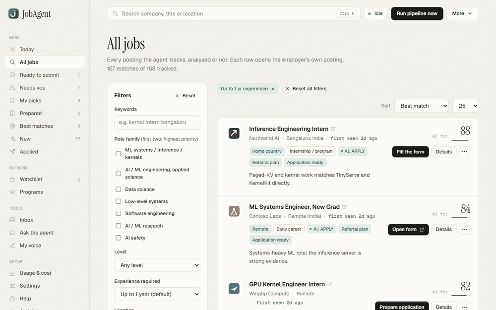

**My picks:** what you're working on, who you know at each company, and the referral plan.

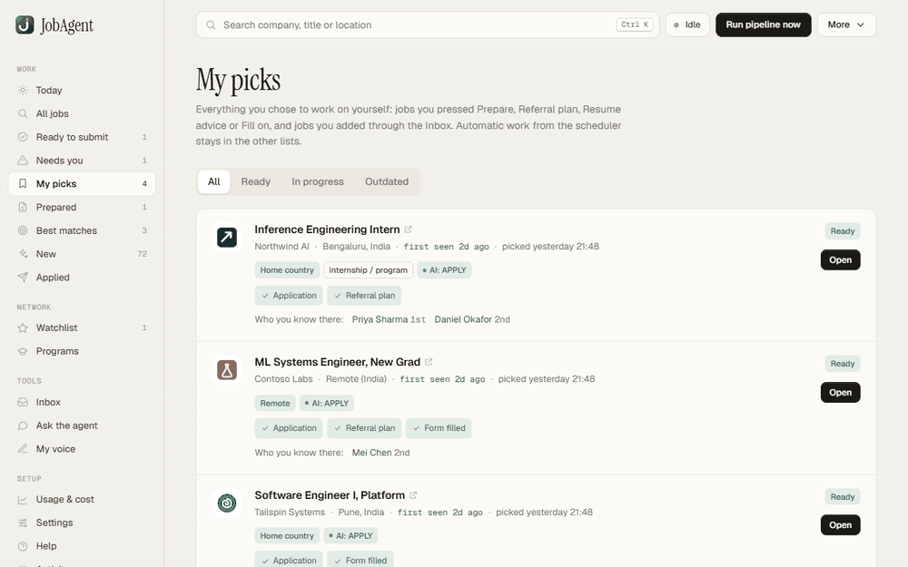

**Ctrl K anywhere:** jump to any view, find a job by name, or run a / command (see the top of this page).

| Today, light | Today, dark |
|---|---|
| 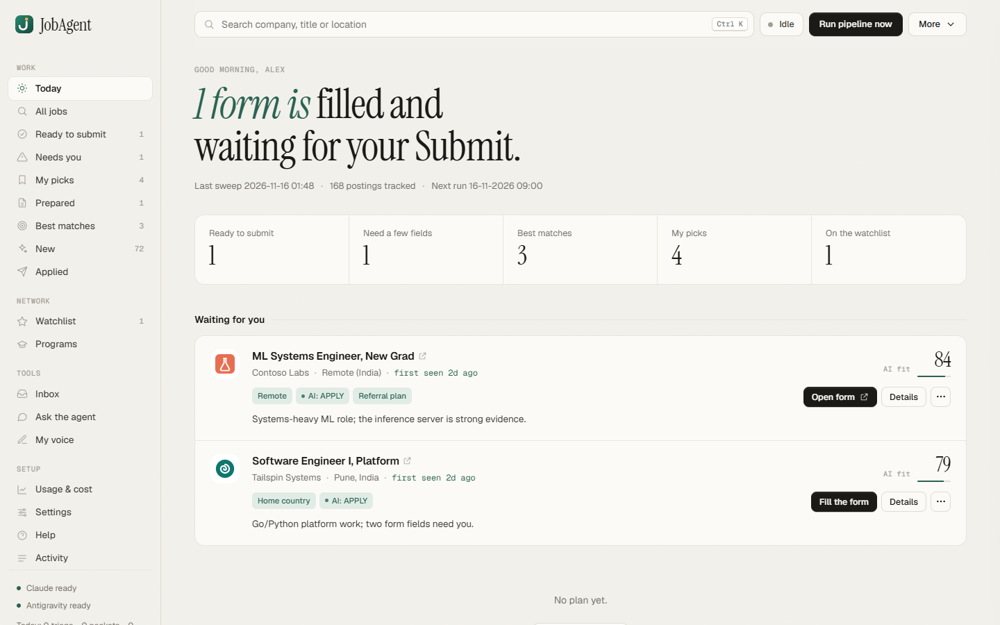 | 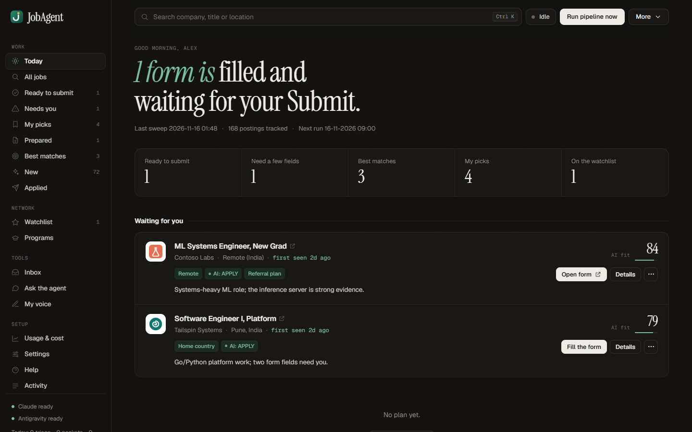 |

| Inbox | Usage & cost |
|---|---|
| 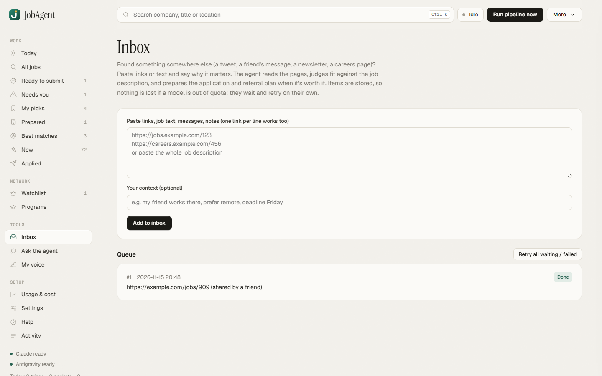 | 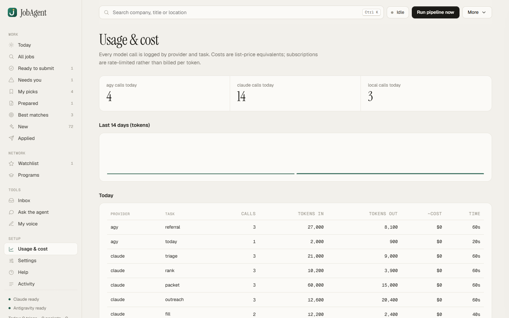 |

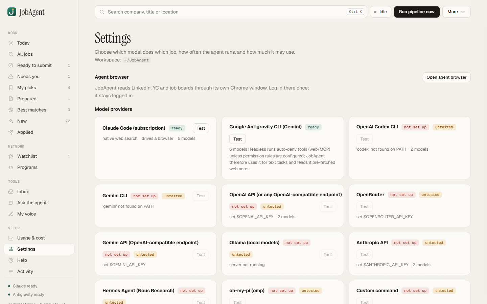

---

## 5. Ask the agent: plain words or slash commands

**Plain words.** Write what you want, for example *"who do I know at Stripe, then plan a referral for the SWE intern role"*.
- The agent does exactly that and posts the result into the chat when it finishes: the people found, with profile links and how to reach each, or the honest reason something could not run.
- Preparation work starts right away.
- `fill`, `mark` and multi-step `agent` goals start only when your words ask for them; otherwise you get a confirm button.

**Slash commands** use the same verbs as the CLI.
- They run instantly and need no AI model, so they work even when every provider is out of quota.
- Type `/` for the menu, or open the *Commands: a 1-minute tour* panel under the chat box.
- `<job>` is a job id from `/top` or `/jobs`, or company/title words: `/referral datadog applied science`. If the words match several jobs, they are listed for you.

| Group | Commands |
|---|---|
| Basics | `/help [cmd]` `/status` `/usage` |
| Find | `/top [n]` `/jobs <words>` `/picks` `/watch` `/needs` |
| Prepare | `/packet <job>` `/referral <job>` `/linkedin <job>` `/connections <picks \| needs-you \| companies>` `/resume <job>` `/fill <job>` |
| Track | `/mark <job> applied\|skip\|dismissed [reason]` `/add <link or text> [-- context]` `/retry` `/inbox` `/remember <fact>` |
| Run | `/scout` `/today` `/poll` `/cycle` `/yc-profile` `/reflect` `/agent <goal>` |

Add `force` to a job command to prepare a job the eligibility gate rejected (`/packet <job> force`).

(See the GIF at the top of this page.)

**The agent loop** (`/agent <goal>` or `jobagent agent "<goal>"`) handles multi-step goals with tools:
- search the pipeline, and **recall** what is already known (retrieval over jobs, plans, people and memory)
- **read any web page through your browser**
- **find people on LinkedIn**, and check who you know at a list of companies
- prepare packets and referral plans, search the web

It plans first, keeps its context small by folding old tool results, works with any provider, and cannot submit applications or change settings.

---

## 6. The browser: LinkedIn, YC, job boards, any page

JobAgent drives its **own Chrome window** (your logins live there) through Playwright. Reading pages is done by small scripts, not by an AI looking at raw HTML, so browsing is fast and costs no model tokens.

| Capability | How |
|---|---|
| LinkedIn people at a company | People search, 1st degree first, then 2nd degree with the mutual connections who can introduce you. Only people whose **current employer** is the company count ("ex-Stripe" doesn't). Cached for 7 days. |
| A person's profile | Headline, About, Experience and recent activity, to find a specific hook. |
| YC Work at a Startup | Your logged-in job lists with the visa field, and your profile. |
| Company career pages / ATS | Full job descriptions (JavaScript-rendered pages included) and application forms. |
| Any page | `open_page`, `find_on_page`, and a read-only multi-step `browse_task` for the agent. |

**Safety:**
- On LinkedIn an always-on guard blocks Connect, Message, Follow, Like, Comment and Send.
- Page loads are paced like a person and capped per run.
- A login wall or security check stops the run with a clear message.
- You send every message yourself.

> Automated use of a logged-in LinkedIn account goes against LinkedIn's terms. Keep it to your own job search and keep the volume low; the daily background cap is 3 companies, and jobs you ask for yourself aren't capped.

---

## 7. Referrals: real people, real messages

`/linkedin <job>` (or `/referral <job>`, or the *Referral plan* button) writes `REFERRAL.md` in the job's folder:
1. **Who:** real 1st- and 2nd-degree people at the company, seen in your network just now, each with a profile link.
2. **Ranking:** one small model call ranks them by relevance, approachable seniority, a named mutual connection for an intro, and activity. It can only pick people it was shown, so it never adds anyone.
3. **The plan:** strategy, timing (apply and ask in parallel; one follow-up after 5–7 days) and prep actions tied to *their* work.
4. **Messages in your voice:**
   - a connection note (only if you're not connected)
   - a short and a longer message
   - an intro request to the mutual connection
   - one follow-up
   - a blurb a referrer can forward

**No guessing.** People found on the public web are kept only if their page was actually read and shows their name and the company. There are no "UNVERIFIED" entries. If nobody reachable is found, the plan says so and tells you what to do: `/connections <company>`, or drop LinkedIn's connections export into `<workspace>/data/`.

`/connections picks` (or `needs-you`, or a list of companies) checks your network at every company in one paced, read-only browser session, with no model cost.

---

## 8. The eligibility gate: full job descriptions

Feeds often carry only a teaser, so nothing gets a packet, a referral plan or a form fill until the **full posting** has been read and checked. Every check below is deterministic: no model is involved.

| Check | Example that rules a job out |
|---|---|
| Years of experience | "3+ years", "two years", "5–7 years"; per-degree ladders such as "5+ years (Bachelor's) / 1+ (PhD)" use your degree's number. More than 1 year rules a job out. |
| Required degree | "Pursuing an MS or PhD", "PhD required". Mentions like "open to all degree levels" or alumni stories don't count. |
| Seniority | Senior, Staff, Principal, Lead, Manager, level II/III titles. |
| Citizenship / clearance | "must be a U.S. citizen", "active secret clearance", ITAR. |
| Graduation window | "for 2026 graduates" when you graduate in 2027. |
| Closed postings | "no longer accepting applications": the job is hidden. |

- **Before triage:** jobs that fail are dismissed before triage, which also saves tokens.
- **Audit:** `jobagent audit` re-checks everything you've already picked or prepared and marks problems in My picks. It deletes nothing.
- **Override:** if you still want a rejected job, add `--force` (CLI) or `force` (chat).

---

## 9. Form filling (never submits)

1. The form is read by a script, across iframes too (for example Greenhouse forms embedded on company sites): labels, types, options, required fields.
2. **One** model call maps your facts and prepared answers onto those fields. That's about 6k tokens, where a model driving the browser used about 490k.
3. Playwright fills text fields, dropdowns, type-ahead lists, radios and checkboxes, and uploads your resume, cover letter and (only when asked) transcript.
4. The result is checked. The report lists exactly what needs you: fields with no answer in your data, dropdowns picked from suggestions that you should glance at, and legal attestations, which are always left to you.
5. The tab stays open. You review it and press Submit.

**Safety layers:**
- A page guard blocks submit buttons, submit events and application POST requests for 45 minutes, with a banner on the page.
- Nothing in the code ever clicks submit.
- A watchdog warns if a confirmation page ever appears.
- Account-wall systems (Workday, iCIMS, Taleo) are detected and left for you.

If a form can't be read, a model-driven fill takes over; it's slower and costs more.

---

## 10. Models: hosted, mixed, and local AI

**Settings → Which model does which job** sets a provider, model and effort for each task. Providers are detected automatically, and if one is missing, out of quota or over budget, the next in the fallback chain is used.

**Recommended mix when you have both Claude Code and Antigravity:**
- **Claude:** triage, chat, inbox, packets, outreach, resume, ranking people, form mapping, LinkedIn and YC.
- **Antigravity (Gemini):** referral research, scouting, the daily plan and reflection.

Each falls back to the other. The setup wizard proposes a mix for whatever you have installed.

### Local AI (free, on your GPU)

`jobagent local-setup`:
1. Detects your GPU, VRAM, RAM and disk.
2. Recommends a model that fits.
3. Downloads the right [llama.cpp](https://github.com/ggml-org/llama.cpp) build: CUDA, Metal, Vulkan or CPU.
4. Starts it silently in the background.
5. **Benchmarks it against your main model on your own triaged jobs.** The cheap tasks (triage, inbox extraction, ranking people, browsing steps, today, reflect, scout) are routed to the local model **only if it agrees with your main model at least 85% of the time**. Your hosted model stays as the fallback.

| Your hardware | Recommendation |
|---|---|
| NVIDIA GPU with 8 GB+ VRAM, or Apple Silicon with 16 GB+ | **Qwen3.5-9B Q4_K_M** (~5.7 GB), fully on the GPU, 16k context, about 50+ tokens/s on 8 GB laptop GPUs |
| 6 GB GPU, or 16 GB RAM with no GPU | Qwen3.5-4B Q4_K_M (CPU runs are slow, but fine overnight) |
| Less | Stay on hosted models |

How it keeps the intelligence while running small:
- **Thinking where it pays:** hybrid-thinking models reason step by step only for reflection, the daily plan and chat. Triage, ranking and extraction answer directly, because long reasoning on batch tasks burned the whole output budget without answering. If a reasoning run ever comes back empty, it is retried without thinking.
- **Valid JSON by construction:** structured tasks use llama.cpp's grammar-constrained decoding (an array or object schema matched to the prompt) at a low temperature, so malformed output is impossible and judgements stay consistent.
- **A second opinion where it matters:** when the local model says SKIP on a job the rules score highly, your main hosted model takes one more look (a few per run). A small model never silently throws away a good opportunity.
- **Quality gate:** the agreement benchmark must pass before routing changes, and `local-bench` lists every disagreement so you can see which way it errs.
- **Smooth to run:** it starts on first use (about 10 s), and frees the GPU after each scheduled run (`llm.local.keep_running` keeps it loaded). It is also the last fallback when hosted quotas run out. Context is 32k tokens.

Measured on an RTX 5060 Laptop (8 GB) with Qwen3.5-9B Q4_K_M:

| Metric | Result |
|---|---|
| Generation speed | about 53 tokens/s |
| Prompt reading | about 2,000 tokens/s |
| GPU memory | 7.4 GB |
| Agreement with Claude on triage | 90% (27 of 30 jobs) |
| Time for those 30 jobs | 66 s |

### Which tasks should go to the local model (and how to set it)

`local-bench --apply` sets a safe default. This is the full map, with the reasoning, if you want to tune it yourself. Set it in **Settings → Which model does which job**, or in `<workspace>/config/settings.json`:

| Task | Local model? | Why |
|---|---|---|
| `triage` | **yes** | Batch classification with a reason per job. Constrained JSON keeps it valid, and a hosted second opinion catches borderline skips. |
| `ingest` | **yes** | Extracts jobs from pasted text and links into a fixed schema. |
| `rank` | **yes** | Ranks people already seen on LinkedIn. It can only choose from that list. |
| `browse` | **yes** | One read-only browsing decision per page (which link next). |
| `webplan` | **yes** | Writes search queries for research. |
| `today`, `reflect`, `scout` | **yes** | Short plans and memory updates; reasoning mode is on for these. |
| `chat`, `agent` | hosted (local as fallback) | Multi-step judgement over many tools is where bigger models are clearly better. The local model takes over when hosted quotas run out, with schema-constrained tool calls. |
| `packet`, `outreach`, `resume` | hosted | Writing a person reads: tone and judgement matter most. |
| `referral` | hosted with web | Research needs live web search. |
| `fill`, `linkedin`, `yc` | hosted | Form mapping touches legal answers; the browser fallback needs a browser-capable provider. |

```json
{
  "llm": {
    "routing": {
      "triage": {"provider": "local", "model": "local"},
      "ingest": {"provider": "local", "model": "local"},
      "rank":   {"provider": "local", "model": "local"},
      "browse": {"provider": "local", "model": "local"},
      "webplan":{"provider": "local", "model": "local"},
      "today":  {"provider": "local", "model": "local"},
      "reflect":{"provider": "local", "model": "local"},
      "scout":  {"provider": "local", "model": "local"},
      "chat":   {"provider": "claude", "effort": "low"},
      "agent":  {"provider": "claude", "effort": "medium"},
      "packet": {"provider": "claude", "effort": "high"}
    },
    "fallbacks": ["claude", "agy", "local"],
    "local": {
      "model": "unsloth/Qwen3.5-9B-GGUF:Q4_K_M",
      "ctx": 32768, "max_tokens": 6144, "max_tokens_thinking": 4096,
      "thinking_kinds": ["reflect", "today", "chat"],
      "second_opinion_min_score": 66, "second_opinion_max": 6,
      "keep_running": false, "autostart": true
    }
  }
}
```

**Tuning knobs:**
- `thinking_kinds`: tasks where the model reasons before answering.
- `second_opinion_*`: when the hosted model re-checks a local SKIP.
- `keep_running`: keep the model loaded on the GPU between runs.

Why not a bigger model on an 8 GB laptop? 30–35B MoE models such as Qwen3.6-35B-A3B or GLM-4.7-Flash need about 18–20 GB of weights. With CPU offload that fits a 24 GB-VRAM card or a Linux machine with plenty of free RAM, but on an 8 GB laptop running Windows it pages and crawls. Writing that a human reads (cover letters, outreach, resume advice) stays on your best hosted model either way.

Other commands: `local-status`, `local-start`, `local-stop`, `local-bench [--apply]`. Ollama and LM Studio also work, as OpenAI-compatible providers.

`jobagent bench` compares your providers on your own data: agreement, speed, tokens, and whether research links are alive.

---

### Context management and guardrails

These apply to every model, hosted or local.

| Risk | What JobAgent does |
|---|---|
| **Invented facts** in letters, answers and messages | Every figure (metrics, percentages, counts with units) is checked against your profile, the job description and the research it was given. An unsupported figure goes into the one batched rewrite with "remove it or use a number from the profile", and anything left is flagged in the packet. Your profile's hard rules ("one internship, no publications") are in every writing prompt. |
| **Made-up people or links** | Referral plans only contain people actually seen on LinkedIn or on a page that was read. Links in chat and agent answers that never appeared in a source or tool result are removed and the removal is noted. |
| **Context rot** (long prompts, stale or irrelevant context) | Prompts carry the few items retrieved for the question (full-text search over jobs, plans, people, facts, memory), not dumps. The agent loop folds older tool results into short notes. A prompt that would exceed a model's context budget goes to a model whose window fits, so it is never silently truncated. |
| **Broken tool calls** | Agent steps and structured tasks are JSON. On the local model they are grammar-constrained to a schema, so a malformed call can't happen. Unknown ids, verdicts or out-of-range scores are rejected or clamped. |
| **Overconfident small model** | Batch tasks answer directly instead of thinking without end. The local model must agree with your main model at least 85% of the time before it gets work, and borderline skips get a hosted second opinion. |
| **Quota exhaustion mid-task** | Background quality work waits for its own provider; interactive work falls back down the chain, ending at the local model. |


## 11. Cost and quota control

| Mechanism | Effect |
|---|---|
| Schedule twice a day (not hourly) | Most of the savings. Polling itself costs nothing. |
| Eligibility gate before triage | Jobs you can't get never reach a model. |
| Deterministic browsing | LinkedIn: about 3k tokens per company instead of about 300k. Forms: about 6k instead of about 490k. |
| Daily caps | 10 packets, 8 referral plans, 3 background LinkedIn scouts, 3 form fills (Settings). |
| Background deferral | When a quality task's provider is busy or out of quota, background work **waits for the next run** instead of being done badly by a fallback. Your own requests still fall back. |
| Quota awareness | A provider that reports its limit is paused until the stated reset; a banner shows it. Background work keeps an allowance free for your own requests. |
| Response cache | Deterministic tasks (triage of an unchanged job, ranking the same people, browsing steps) are answered from cache. |
| Retrieval instead of dumps | Chat and the agent get the 8–10 most relevant items (SQLite full-text search over jobs, plans, people, facts, memory) instead of whole snapshots. |
| One style rewrite per plan | Outreach and cover letters are linted and fixed by rules, with at most one batched model rewrite. |
| Heavy-call log | Any call over 50k input tokens is logged so you can see what to tune. |

**Usage & cost** in the GUI (or `/usage`) shows calls and tokens per provider and task.

---

## 12. Command line reference

`jobagent <command>` is the same as `python agent/run.py <command>`.

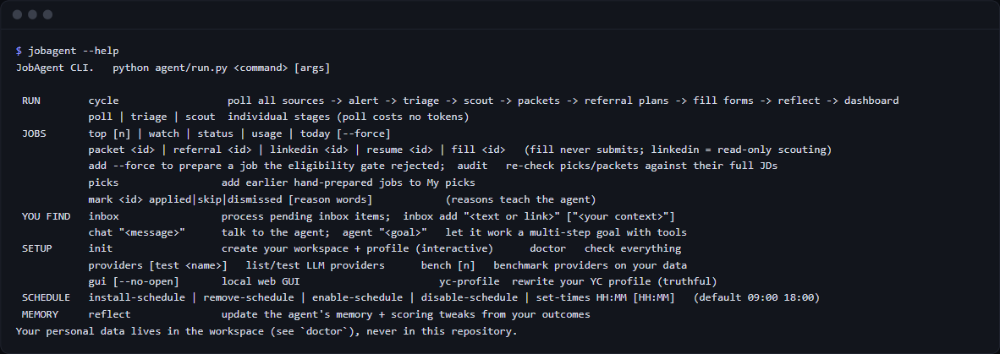

| Command | What it does |
|---|---|
| `init [--reconfigure] [--defaults]` · `doctor` | Setup wizard · check everything. |
| `gui [--no-open]` | The app. |
| `cycle` · `poll` · `triage` · `scout` | Full run · single stages. |
| `top [n]` · `status` · `watch` · `usage` | What to look at · counts · watchlist · model usage. |
| `packet <id>` · `referral <id>` · `linkedin <id>` · `resume <id>` · `fill <id>` | Prepare · plan contacts · LinkedIn scouting · resume advice · fill (never submits). Add `--force` to override the eligibility gate. |
| `connections [picks\|needs-you\|"A, B"]` | Who you know at each company (LinkedIn, read-only, no model cost). |
| `audit` | Re-check picks, packets and the watchlist against full job descriptions. |
| `mark <id> applied\|skip\|dismissed [reason]` | Record an outcome; reasons teach the agent. |
| `inbox [add "<text>" "<context>"]` · `inbox retry` · `chat "<message or /command>"` · `agent "<goal>"` | Your own finds · retry waiting items · chat · multi-step goals. |
| `picks` | Add earlier hand-prepared jobs to My picks. |
| `today [--force]` · `reflect` · `dashboard` | Daily plan · update memory · HTML dashboard. |
| `providers [test <name>]` · `bench [n]` | List or test providers · benchmark on your data. |
| `local-setup` · `local-status` · `local-start` · `local-stop` · `local-bench [--apply]` | Local AI. |
| `install-schedule` · `remove-schedule` · `enable-schedule` · `disable-schedule` · `set-times HH:MM [HH:MM]` | Scheduling (Task Scheduler, cron or launchd). |
| `yc-profile` | Truthful rewrite of your YC Work at a Startup profile. |

| `jobagent top 6` | `jobagent doctor` |
|---|---|
| 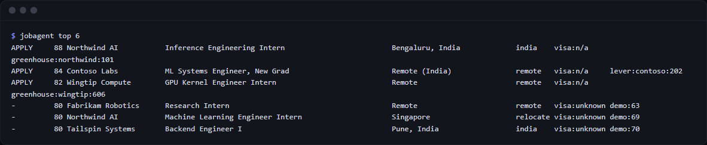 | 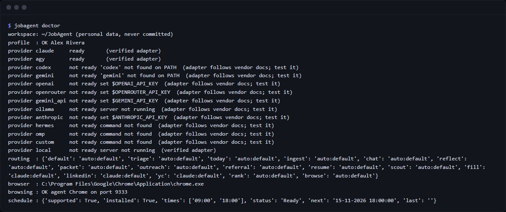 |

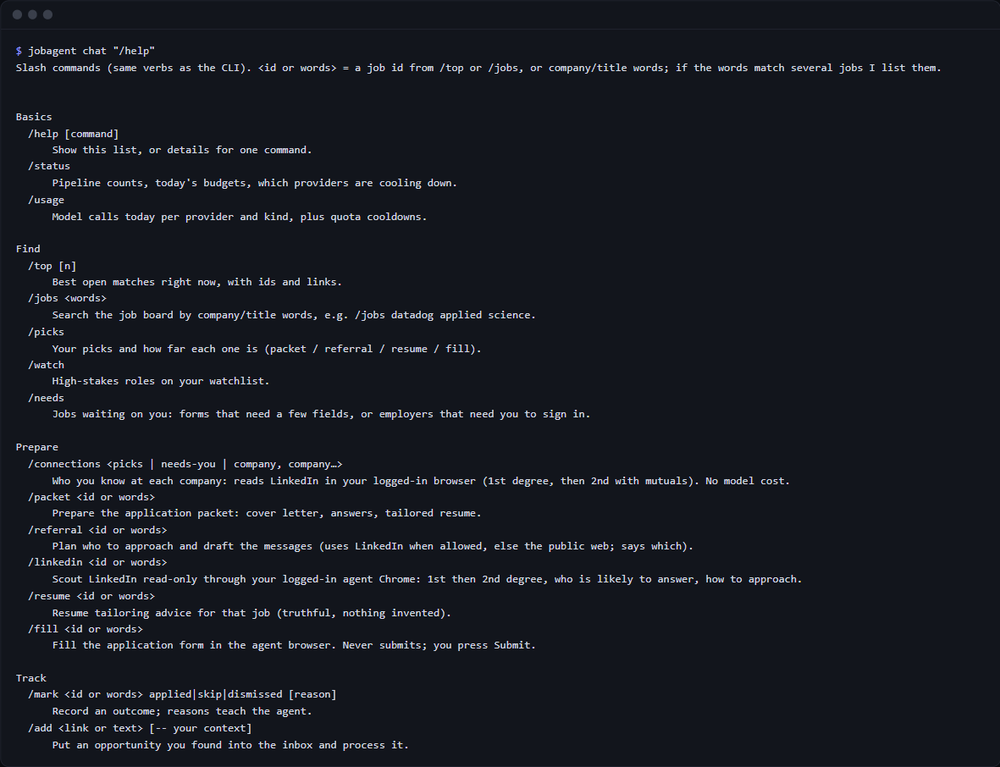

---

## 13. Configuration

Edit settings in the GUI (**Settings**) or in `<workspace>/config/settings.json`. That file holds only your overrides; the shipped defaults are in `defaults/settings.json`.

| Key | Meaning |
|---|---|
| `schedule_times` | When it runs by itself (`["09:00","18:00"]`). |
| `llm.routing.<task>` | Provider, model and effort per task (`triage, ingest, chat, packet, outreach, resume, referral, scout, today, reflect, fill, linkedin, yc, rank, browse`). |
| `llm.fallbacks` | Order to try when a provider is unavailable. |
| `llm.budgets.<provider>` | Daily call/token caps; `background_calls_per_5h` keeps room for your own requests. |
| `llm.defer_in_background` | Tasks that wait instead of falling back during scheduled runs. |
| `llm.cache_hours.<task>` | Response-cache lifetime per task. |
| `llm.local` | Local model (`model`, `autostart`). |
| `jd_gate.max_yoe` | The most required years that still counts as eligible (default 1). |
| `max_packets_per_day`, `max_referrals_per_day`, `max_linkedin_per_day`, `max_fills_per_day`, `packets_per_cycle`, `referrals_per_cycle`, `max_triage_calls_per_day` | Volume caps. |
| `auto_fill`, `fill_window_local_hours`, `guard_minutes` | Form filling. |
| `connections_max_companies` | Companies per `/connections` run. |
| `notify.ntfy_topic` | Phone pushes. |
| `web.search_backend` | `ddg`, or `brave` with `$BRAVE_API_KEY`. |
| `ui.logos` | Company logos in the GUI. |

**Other files:**
- `filters.json`: title families and weights, exclusions, visa weights, home locations.
- `companies.json`: boards to poll.
- `profile.json`: your facts, resume variants, hard rules ("never claim X"), form defaults.

Anything left empty in `form_defaults` is never guessed: it shows up under **Needs you**.

---

## 14. Privacy and safety

- **Your data:** all personal data lives in your workspace: profile, database, applications, referral plans, voice samples, memory, browser profile and logs. The code folder holds no personal data.
- **What leaves your machine:**
  - prompts to the AI providers you configured
  - page requests to job boards and LinkedIn, made through your own browser
  - company domain names for logos (can be turned off)
- **Your hands on the wheel:**
  - It never submits an application.
  - It never sends a message, and never clicks Connect or Follow.
  - It never creates accounts or solves CAPTCHAs.
  - Legal attestations are always left to you.
- **Honest content:** the hard rules in your profile (for example "one internship, no publications") apply to every letter, answer and message.

---

## 15. Troubleshooting and FAQ

- **`doctor` says browsing NOT READY:**
  - Install Chrome, Edge or Chromium, or re-run the installer.
  - On minimal Linux, also run `sudo .venv/bin/python -m playwright install-deps chromium`.
- **"LinkedIn wants you to log in":** open the agent's browser (Settings → Open agent browser), log in once, then retry.
- **A referral plan names nobody:** you have no 1st- or 2nd-degree connections there right now. Try `/connections <company>` with related companies, or add LinkedIn's connections export.
- **A job you wanted was rejected:** the reason is shown (for example "needs 3+ years"). If you disagree, use `--force` / `force`.
- **Fill says PARTIAL:**
  - The listed fields need answers only you have (offer deadlines, consent choices).
  - Dropdowns marked "please check" were picked from suggestions.
- **Fill says BLOCKED:** the employer's system wants an account. Use the packet to apply by hand.
- **A provider "quota reached":** it resumes at the time shown. Your own requests use the fallback provider, and background work waits.
- **Nothing ran at 09:00:** run `jobagent doctor` and check the `schedule` line. The computer must be on: Task Scheduler and cron don't wake a sleeping laptop, but launchd runs a missed job when the machine wakes.

---

## 16. For developers

- **Code layout:**
  - `agent/` holds the code (standard library plus Playwright). Key modules:
    - `browse.py`: browser layer
    - `jd.py`: eligibility gate
    - `rag.py`: retrieval
    - `formfill.py`: deterministic form filling
    - `local_ai.py`: local models
    - `chatcmd.py`: chat commands
    - `agentic.py`: agent loop
    - `llm.py`: providers, routing, cache, deferral
  - `defaults/`: shipped config and skills.
  - Design notes are in [docs/ARCHITECTURE.md](docs/ARCHITECTURE.md).
- **Tests:** `python -m unittest discover -s tests` runs against a throwaway workspace. CI runs them on Ubuntu, macOS and Windows.
- **Demo data:** `python tools/make_demo.py <folder>` builds a workspace with fictional companies and people. Open it with `JOBAGENT_HOME=<folder> python agent/run.py gui`.
- **Images in this README:** come from the demo. Run `tools/screenshots.py` and `tools/record_gifs.py --url <gui url>`; these need Pillow, `python -m pip install pillow`.
- **Publishing a copy:** the tree contains no personal data, but the git history of a personal fork may. Start a fresh history before making a copy public, and never commit a workspace.
